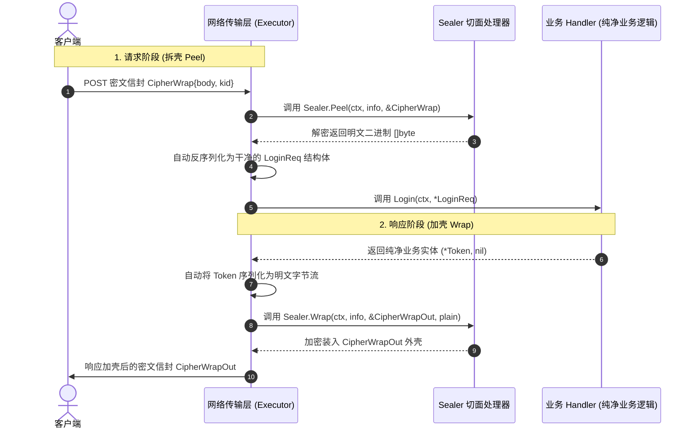

# 信封机制与传输安全加解密 (Seal Envelopes & Security)

在政企、金融、移动端通讯以及敏感数据传输场景中，接口往往需要强安全外壳加固：如国密 SM2/SM4 端到端加密、AES 密文信封传输、防篡改签名戳（Signature/Nonce/Timestamp）等。

如果这些加解密和验签逻辑侵入到业务层，会导致业务代码充斥着繁重晦涩的编解码样板；如果只放在 API 网关层，又会导致内部微服务无法校验原始契约。

Resgen 首创了 **声明式 Seal 信封自动化拆封与封壳机制**，在网络传输物理层与后端 Handler 纯净业务入参之间构建了一道智能的安全屏障。

---

## 1. 核心运行机制



---

## 2. 信封模型与 DSL 声明语法

### 2.1 物理信封声明（使用普通的 input 或 type）
信封本身是一个定义了网络层物理字段的结构体（通常使用泛型 `<T>` 承载业务载荷）：

```graphql
module SecureService

# 1. 入参解密信封结构
input CipherWrap<T> {
    body: String! @payload(T) # 密文载荷，@payload(T) 表达解密后为类型 T
    kid:  String  @header     # 密钥版本，物理层置于 HTTP Header
    iv:   String!             # 初始化向量
}

# 2. 出参加密信封结构
type CipherWrapOut<T> {
    cipher:    String! @payload(T)
    signature: String!
}
```

### 2.2 接口挂载信封 (`[seal=...]`)

在接口的方法名左侧声明**入参信封**，在返回类型右侧声明**出参信封**：

```graphql
group /secure {
    # ① 双向信封：入参自动解密拆壳，出参自动加密封壳
    POST /login [seal=CipherWrap<LoginReq>] => Login(input: LoginReq!): Token [seal=CipherWrapOut<Token>]

    # ② 单向信封：入参为密文信封，出参为明文响应
    POST /query [seal=CipherWrap<QueryReq>] => QueryData(input: QueryReq!): QueryResult

    # ③ 单向出参加壳：入参为明文，出参为加密信封
    POST /token => GetSecretToken(input: SimpleReq!): Token [seal=CipherWrapOut<Token>]
}
```

> [!NOTE]
> **业务 Handler 纯洁性**：
> 无论信封机制多么复杂，业务代码中的 Handler 方法签名**永远是干净纯粹的**：
> `Login(ctx context.Context, input *LoginReq) (*Token, error)`
> 业务研发人员只需专注于处理业务逻辑，无需触碰加解密实现！

---

## 3. `@payload` 明文辅助契约指令

`@payload` 是 Resgen 提供的核心辅助指令。它在不改变物理字段底层类型（保持 `String` 字符串）的前提下，向 API 契约和前端表达该字段解密/解封后的明文结构：

### 3.1 泛型信封模板参数关联
在泛型结构中绑定载体字段与泛型类型 `T`：
```graphql
input CipherWrap<T> {
    body: String! @payload(T)
}
```

### 3.2 独立明文辅助说明（无 seal 场景）
对于业务需要手动解密的普通字段，也可独立使用 `@payload` 辅助说明其内部明文结构：
```graphql
input ThirdPartyReq {
    # 物理层是字符串，通过 @payload 声明解密后为 UserProfile 结构
    encrypted_data: String! @payload(UserProfile)
}
```

在导出的 `api.html` 交互式文档中，标注了 `@payload` 的字段会自动展开一个内嵌的 **Payload 明文卡片**，清晰展示其明文字段定义与说明。

---

## 4. Go 侧 Sealer 实现契约与引擎注册

生成器会为每个信封模型生成对应的加解密切面契约：

```go
type CipherWrapSealer interface {
    // Peel: 从密文信封中解出业务明文字节流
    Peel(ctx context.Context, info MethodInfo, env *CipherWrap) ([]byte, error)

    // Wrap: 将业务明文字节流加密并填入出参信封对象
    Wrap(ctx context.Context, info MethodInfo, env *CipherWrapOut, plain []byte) error
}
```

### 4.1 业务 Sealer 实现范例
```go
type MyCipherSealer struct{}

func (s *MyCipherSealer) Peel(ctx context.Context, info resolver.MethodInfo, env *resolver.CipherWrap) ([]byte, error) {
    // 1. 调用 SM4/AES 对 env.Body 进行解密
    plainBytes, err := decryptSM4(env.Body, env.Kid, env.Iv)
    if err != nil {
        return nil, fmt.Errorf("解密失败: %w", err)
    }
    return plainBytes, nil
}

func (s *MyCipherSealer) Wrap(ctx context.Context, info resolver.MethodInfo, env *resolver.CipherWrapOut, plain []byte) error {
    // 2. 将响应明文加密，并填入出参外壳
    cipherText, sign, err := encryptSM4AndSign(plain)
    if err != nil {
        return err
    }
    env.Cipher = cipherText
    env.Signature = sign
    return nil
}
```

### 4.2 引擎注册
在服务初始化阶段将 Sealer 绑定到 Engine：
```go
engine := resolver.NewEngine[*gin.Context]()
engine.BindCipherWrapSealer(&MyCipherSealer{})
```

---

## 5. 结构化错误与多语言 (i18n) 支持

为了防止加解密失败时抛出不可控的混乱错误，Resgen 提供了标准化的结构化错误类型，天然支持企业级多语言映射：

### 5.1 启动期自检结构化错误 (`MissingSealerError`)
当开发者为某个接口配置了 `[seal=CipherWrap]`，但在启动时遗漏了 `engine.BindCipherWrapSealer(...)`，引擎的 `CheckSealers` 方法会返回强类型的 `MissingSealerError`：

```go
type MissingSealerError struct {
    Envelope string // 缺失的信封名称，如 "CipherWrap"
    Method   string // HTTP 动词，如 "POST"
    Path     string // 接口路由，如 "/api/secure/login"
}

func (e *MissingSealerError) Error() string {
    return fmt.Sprintf("missing sealer for envelope '%s' (endpoint: %s %s)", e.Envelope, e.Method, e.Path)
}
```

### 5.2 运行期信封异常结构化包装 (`EnvelopeError`)
在接口运行过程中，若拆封（Peel）或加封（Wrap）发生异常，框架会统一封装为 `EnvelopeError`：

```go
type EnvelopeError struct {
    Envelope string // 信封模型名称
    Stage    string // 发生阶段: "peel" (入参解包) 或 "wrap" (出参加壳)
    Code     string // 标准错误码: "NO_SEALER", "PEEL_FAILED", "BAD_PAYLOAD", "WRAP_FAILED"
    Err      error  // 原始底层底层错误
}

func (e *EnvelopeError) Error() string {
    if e.Err != nil {
        return fmt.Sprintf("envelope '%s' failed at %s stage (%s): %v", e.Envelope, e.Stage, e.Code, e.Err)
    }
    return fmt.Sprintf("envelope '%s' failed at %s stage (%s)", e.Envelope, e.Stage, e.Code)
}
```

### 5.3 多语言与 Responder 响应拦截
在实现 `Responder.Bind{Wrapper}` 时，可以通过类型断言捕获该错误并根据客户端语言进行精准翻译：

```go
func (r *MyResponder) BindResData(ctx *gin.Context, data any, err error) resolver.ResData {
    if err == nil {
        return resolver.ResData{Code: 0, Msg: "success", Data: data}
    }

    var envErr *resolver.EnvelopeError
    if errors.As(err, &envErr) {
        // 根据客户端 Accept-Language 进行多语言转换
        lang := ctx.GetHeader("Accept-Language")
        return resolver.ResData{
            Code: 4001,
            Msg:  i18n.Translate(lang, "envelope_error." + envErr.Code, envErr.Envelope),
        }
    }

    return resolver.ResData{Code: 500, Msg: err.Error()}
}
```
