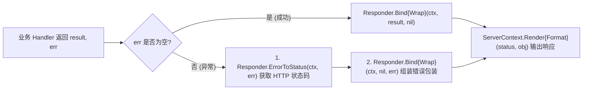

# 统一响应控制与错误处理 (Response Handling & Error Contract)

在现代 Web 体系中，统一、规范且类型安全的 API 响应结构是衡量工程成熟度的关键标准。

Resgen 提供了**声明式包装器 (Wrappers)**、**三级覆盖响应控制**、**编译期单态化平铺**以及**框架无关的响应契约 (Responder)**，构建了业界领先的响应与异常处理闭环。

---

## 1. 响应包装器体系 (Wrappers)

包装器是使用 `wrap` 关键字定义的结构体，用于标准化后端成功与失败时的外层返回格式：

```graphql
# 1. 通用单对象响应外壳
wrap ResData<T> {
    code: Int!     # 业务状态码 (0 表示成功，非 0 表示异常)
    msg:  String!  # 业务提示信息
    data: T        # 实际业务数据载荷
}

# 2. 通用分页/列表响应外壳
wrap ListRes<T> {
    rows:  [T!]!   # 列表行数据
    total: Int!    # 总条数
}

# 3. 原生树形数据响应外壳
wrap TreeRes<T> {
    items: [T!]!   # 树形节点数组
    total: Int!
}
```

---

## 2. 响应流转契约 (The Contract & Flow)

在 Resgen 编译生成的处理方法中，所有响应分支严格遵循以下固定流程：



### 生成的代码范式
```go
// 1. 异常处理分支：data 严格传 nil，err 传入实际错误对象
if err != nil {
    request.RenderJson(e.r.ErrorToStatus(native, err), e.r.BindResData(native, nil, err))
    return
}

// 2. 成功处理分支：使用元数据定义的 successStatus (缺省为 200)，err 传 nil
request.RenderJson(200, e.r.BindResData(native, result, nil))
```

> [!NOTE]
> **错误数据清空铁律**：在发生错误时，框架严格将 `data` 赋予 `nil`，杜绝任何中间半状态脏数据泄露给前端。

---

## 3. 包装器覆盖机制与 `wrap=none`

为了兼顾统一性与灵活性，Resgen 支持**全局默认 + 组级配置 + 接口级按需覆盖**的三级层级机制：

### 3.1 覆盖包装器
```graphql
# 全局默认是 ResData，但本接口返回列表，显式覆盖为 ListRes
GET /users => ListUsers(): [User] [wrap=ListRes]
```

### 3.2 彻底关闭包装器 (`wrap=none`)
在特定场景下，我们希望直接输出原始数据，不包裹任何 JSON 外壳：

```graphql
DELETE /users/:id => DeleteUser(id: Int! @path): String [state=204, wrap=none]
```

#### `wrap=none` 的三大经典黄金场景：
1. **防止双重套壳**：当返回类型本身已经是包装器时，避免被外层再次包裹成 `ResData<MyWrapper<T>>`；
2. **纯原始/流式数据输出**：返回纯文本（`ctype=text`）、静态 HTML（`ctype=html`）或流式文件下载（`File`），不应受 JSON 外壳干扰；
3. **空内容响应 (204 No Content)**：当状态码指定为 `state=204` 时，配合 `wrap=none` 使得接口成功时直接输出空响应体，严格贴合 HTTP/RESTful 标准。

---

## 4. 嵌套泛型包装器编译期单态化展开 (Monomorphization)

在很多业务中，我们既需要最外层的统一状态码包装 `ResData`，又需要内层的分页结构 `ListRes`。传统框架往往需要手动写一个 `ResDataListUser` 的重复结构体。

Resgen 支持在 DSL 中**直接书写双重嵌套泛型**：

```graphql
group /articles [wrap=ResData] {
    # 直接声明外层 ResData 包裹内层 ListRes<Article>
    GET /list => ListArticles(page: Int, size: Int): ResData<ListRes<Article>>
}
```

### 🧬 单态化展开核心机制
编译器在生成 Go 代码时，会自动识别非顶层 wrapper 的嵌套泛型，并对其执行**单态化平铺展开**：
1. **自动生成具体 struct**：编译器会自动生成非泛型的具体化结构体：
   ```go
   type ListResArticle struct {
       Rows  []Article `json:"rows"`
       Total int       `json:"total"`
   }
   ```
2. **强类型业务方法签名**：业务 Handler 的签名精准推导为具体结构体指针，享受最佳的类型提示：
   ```go
   ListArticles(ctx context.Context, input *ListArticlesArgs) (*ListResArticle, error)
   ```
3. **外层自动脱壳与装壳**：外层的 `ResData` 外壳在 Handler 执行完成后，由框架在渲染阶段底层自动包回，业务层只需返回列表和总数即可！

---

## 5. 统一错误处理与多语言 (i18n) 实践

在实现 `Responder` 接口时，通过结合 `ctx` 能够极其优雅地构建多语言错误中心：

```go
type MyResponder struct{}

func (r *MyResponder) ErrorToStatus(ctx *gin.Context, err error) int {
    if err == nil {
        return 200
    }
    // 根据业务错误类型定制 HTTP 状态码
    var notFoundErr *ErrNotFound
    if errors.As(err, &notFoundErr) {
        return 404
    }
    return 500
}

func (r *MyResponder) BindResData(ctx *gin.Context, data any, err error) resolver.ResData {
    if err == nil {
        return resolver.ResData{Code: 0, Msg: "success", Data: data}
    }

    // 1. 获取客户端语言
    lang := ctx.GetHeader("Accept-Language")

    // 2. 识别枚举非法校验错误 (InvalidEnumError)
    var enumErr *resolver.InvalidEnumError
    if errors.As(err, &enumErr) {
        return resolver.ResData{
            Code: 4002,
            Msg:  fmt.Sprintf("字段 '%s' 传入了非法的值 '%v'", enumErr.FieldName, enumErr.Value),
        }
    }

    // 3. 识别信封异常 (EnvelopeError)
    var envErr *resolver.EnvelopeError
    if errors.As(err, &envErr) {
        return resolver.ResData{
            Code: 4003,
            Msg:  fmt.Sprintf("安全信封 [%s] 解析失败: %s", envErr.Envelope, envErr.Code),
        }
    }

    // 4. 普通业务异常
    return resolver.ResData{
        Code: 5000,
        Msg:  err.Error(),
        Data: nil,
    }
}
```
