# Resgen 官方技术文档中心

欢迎查阅 **Resgen** 官方文档。Resgen 不仅仅是一个代码生成提效工具，它更是一套内嵌了现代行业最佳实践的 **API 契约设计标准与强类型交付工程体系**。

本文档中心按**功能领域**对 Resgen 的全量特性进行了体系化分类与深度拆解，帮助您在架构设计、契约定义、业务实现和团队协作中快速定位所需指引。

---

## 🗺️ 功能模块指南导航

```mermaid
graph TD
    classDef core fill:#0284c7,stroke:#0369a1,stroke-width:2px,color:#fff;
    classDef flow fill:#059669,stroke:#047857,stroke-width:2px,color:#fff;
    classDef sec fill:#d97706,stroke:#b45309,stroke-width:2px,color:#fff;
    classDef tool fill:#7c3aed,stroke:#6d28d9,stroke-width:2px,color:#fff;

    A[Resgen 契约与引擎]:::core
    A --> B[1. 建模与类型系统]:::core
    A --> C[2. 接口编排与路由]:::flow
    A --> D[3. 切面拦截与校验]:::flow
    A --> E[4. 存储与多协议传输]:::flow
    A --> F[5. 响应控制与异常体系]:::flow
    A --> G[6. 安全信封与自定义标量]:::sec
    A --> H[7. 工程配置与生态工具]:::tool

    B --> B1["01. 类型系统与数据建模"]
    C --> C1["02. 接口编排与参数提取"]
    D --> D1["03. 切面装饰器与校验系统"]
    E --> E1["04. 文件流与上传下载"]
    E --> E2["05. 多协议传输与 Content-Type"]
    F --> F1["08. 响应控制与错误处理"]
    G --> G1["06. 自定义标量系统 (Scalar)"]
    G --> G2["07. 信封机制与安全加解密 (Seal)"]
    H --> H1["09. 配置规格全景指南 (resgen.yaml)"]
    H --> H2["10. 原生 LSP 与开发工具生态"]
    H --> H3["11. Web 框架适配实战指南"]
```

---

## 📚 目录清单与专题导航

| 专题编号 | 功能指南文件 | 核心内容提要 |
|:---|:---|:---|
| **01** | [**数据类型系统与建模规范**](./01_types_and_models.md) | 基础标量、数组与指针映射、修饰符组合全景、`type`/`input` 模型、枚举 `enum`、联合多态 `union`、树形包装器 `TreeRes`。 |
| **02** | [**接口编排与参数提取机制**](./02_endpoints_and_routing.md) | 模块 `module` 与分组 `group`、HTTP 方法归一化、参数来源提取、非 GET 请求平铺参数自动合成、文档注释智能提取。 |
| **03** | [**切面装饰器与校验系统**](./03_decorators_and_validators.md) | 请求/执行/响应装饰器、`global` 与 `specialized` 作用域、权限码提取与金锁文档高亮、上下文校验、`@customBind` 逻辑接管。 |
| **04** | [**文件流与上传下载实战**](./04_file_and_stream.md) | `File` 类型规范、`multipart/form-data` 上传校验、`LocalFileDownload` 强类型载体、`RenderStream` 流式响应与错误优雅降级。 |
| **05** | [**多协议传输与 Content-Type**](./05_content_types_and_protocols.md) | 多协议规格表、结构体 Tag 按需精准推导机制、深层嵌套 Form 表单点分绑定、多态 RawType 延迟反序列化。 |
| **06** | [**自定义标量系统 (Scalar)**](./06_scalars.md) | 标量继承语义、`resgen.yaml` 自动 AST 类型推导、`isolation`（DTO 隔离流）与 `direct`（标量直通流）双生成模式对比。 |
| **07** | [**信封机制与安全加解密 (Seal)**](./07_envelopes_and_security.md) | 网络物理层与业务层解耦、`[seal=...]` 自动拆装壳、`@payload` 明文辅助契约、Sealer 接口、`MissingSealerError` 与 `EnvelopeError` 多语言支持。 |
| **08** | [**统一响应控制与错误处理**](./08_response_handling.md) | 响应包装器体系、`wrap=none` 彻底关闭外壳三大场景、嵌套泛型编译期单态化展开（Monomorphization）、Responder 统一错误映射。 |
| **09** | [**配置规格全景指南 (resgen.yaml)**](./09_configuration.md) | 完整的 `resgen.yaml` 配置清单详解、代码生成规则、命名风格（Case）、首字母缩略词白名单、文档内嵌部署与权限映射约定。 |
| **10** | [**原生 LSP 与开发工具生态**](./10_lsp_and_tooling.md) | 原生语言服务器（`resgen lsp`）、HTTP 动词 Hover 规范指导、实时语义诊断纠错、VSCode 与 JetBrains IDE 官方插件接入。 |
| **11** | [**Web 框架适配实战指南**](./11_framework_adaptation.md) | `ServerContextBase` 通用接口实现、Gin 框架完整适配代码、原生 `net/http` 适配代码、反射与 PC 指针行号秒级直达（`GetHandlerJumpPath`）。 |

---

## ⚡ 附录：全景语法速查手册

如果您希望快速通读或检索 Resgen DSL 的完整语法定义，可以直接查阅单篇全量语法手册：
- 📖 [**Resgen DSL 语法全景指南**](./dsl_guide.md)
